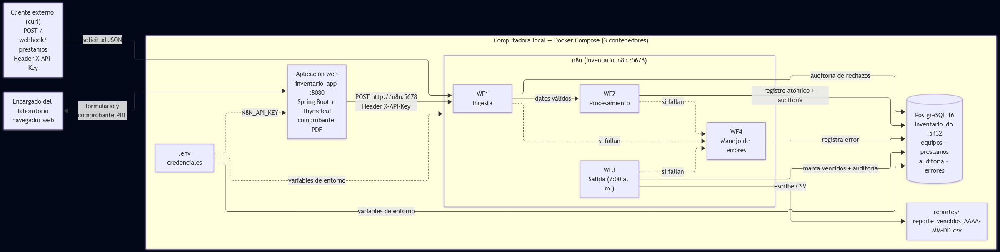
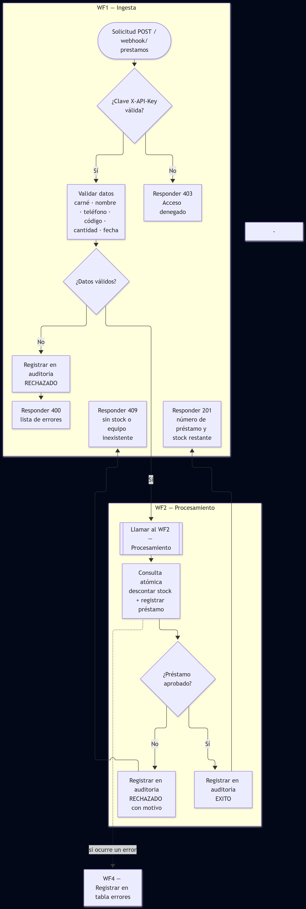
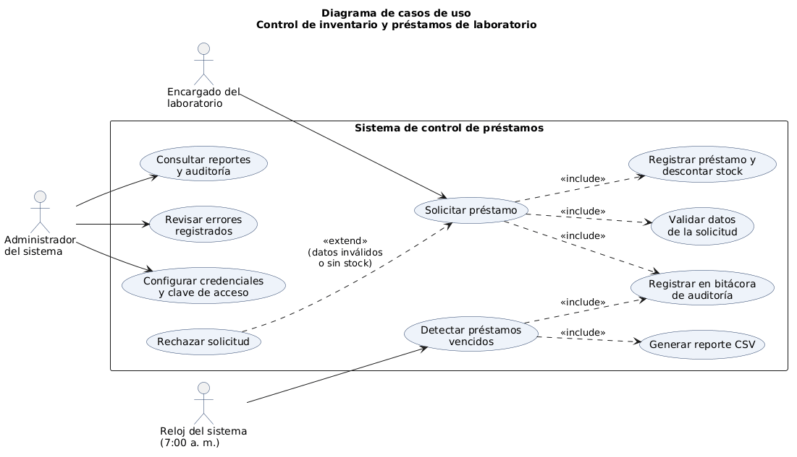
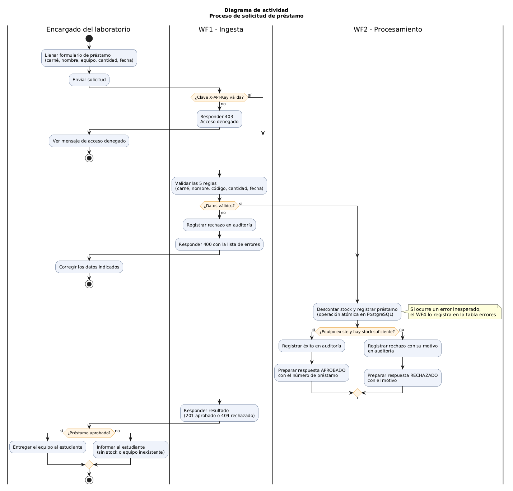
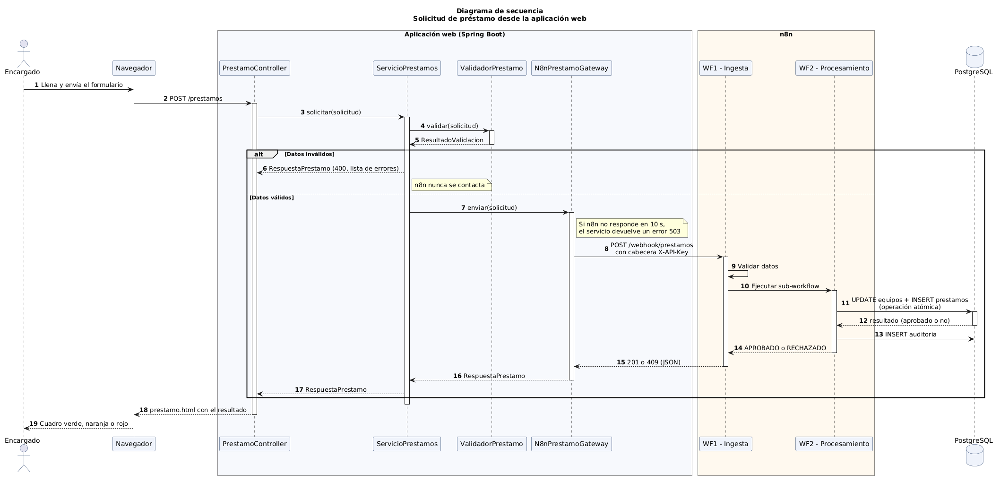
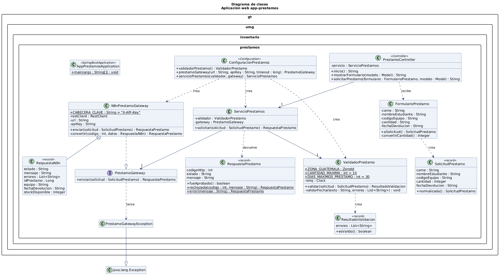
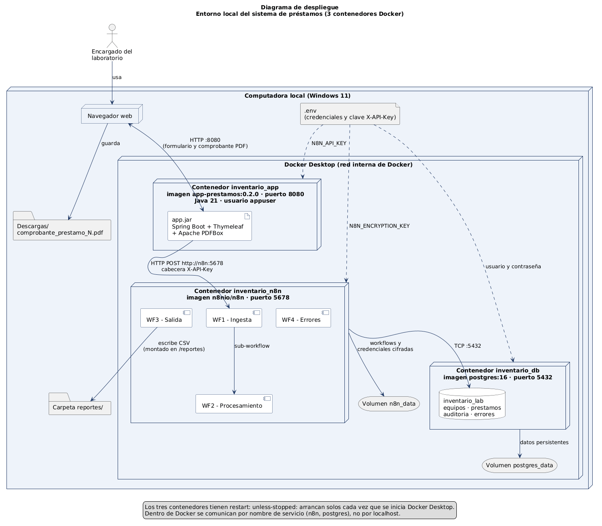

# Control de inventario y préstamos de laboratorio

Proyecto Final — Análisis de Sistemas II (código 037)
Universidad Mariano Gálvez de Guatemala
Docente: Ing. Edgar Raúl Molina Rey

**Autora:** Irma Yaritza Katiuxca Jagan Xol — Carné 4090-23-9748
**Modalidad:** Individual

---

## Descripción

Sistema que automatiza, en un entorno 100 % local, el control de préstamos de equipo de un laboratorio. Usa **n8n** para los workflows, **PostgreSQL** para la persistencia, **Docker** para el despliegue y una **aplicación web en Spring Boot** como interfaz para los usuarios.

El sistema recibe solicitudes de préstamo, valida los datos, verifica el stock disponible, registra el préstamo, descuenta el inventario, entrega un **comprobante en PDF** de cada préstamo aprobado y genera un reporte diario de préstamos vencidos. Todas las operaciones quedan registradas en una bitácora de auditoría, y los errores se capturan en una tabla aparte.

## Arquitectura

Todo corre en **tres contenedores Docker** que arrancan solos al iniciar Docker Desktop (`restart: unless-stopped`):

| Contenedor | Tecnología | Puerto |
|---|---|---|
| `inventario_app` | Aplicación web: Spring Boot 4.1 + Thymeleaf + Apache PDFBox | 8080 |
| `inventario_n8n` | Motor de workflows n8n | 5678 |
| `inventario_db` | PostgreSQL 16 | 5432 |

La carpeta `reportes/` se comparte con n8n para los archivos CSV del WF3.

Flujo principal: **navegador → aplicación web → webhook de n8n (WF1 → WF2) → PostgreSQL → respuesta y comprobante PDF**.

Dentro de Docker, los contenedores se comunican por **nombre de servicio**: la aplicación llama a `http://n8n:5678` y n8n se conecta a `postgres:5432`.

### Workflows

| Workflow | Tipo | Función |
|---|---|---|
| **WF1 – Ingesta de préstamos** | Ingesta | Webhook protegido que recibe y valida la solicitud. Rechaza datos inválidos (400) o llama al WF2. |
| **WF2 – Procesamiento de préstamos** | Procesamiento | Verifica stock, registra el préstamo y descuenta el inventario en una sola operación atómica. Responde 201 (aprobado) o 409 (sin stock). |
| **WF3 – Salida de reportes** | Salida | Todos los días a las 7:00 a. m. marca los préstamos vencidos y genera un reporte en la auditoría y en un archivo CSV. |
| **WF4 – Manejo de errores** | Errores | Error Trigger conectado a WF1, WF2 y WF3. Registra cada fallo en la tabla `errores`. |

### Modelo de datos

| Tabla | Contenido |
|---|---|
| `equipos` | Inventario del laboratorio (stock total y disponible) |
| `prestamos` | Préstamos registrados y su estado (ACTIVO, DEVUELTO, VENCIDO) |
| `auditoria` | Bitácora de todas las operaciones y su resultado |
| `errores` | Fallos capturados por el WF4 |

### Equipos registrados

| Código | Equipo | Stock inicial |
|---|---|---|
| `LAP-001` | Laptop Dell Latitude | 5 |
| `PRO-001` | Proyector Epson | 2 |
| `MUL-001` | Multímetro digital | 8 |
| `ARD-001` | Kit Arduino UNO | 10 |
| `HDM-001` | Cable HDMI 3m | 15 |

Cualquier otro código, aunque tenga el formato correcto, se rechaza con 409.

## Diagramas

Todos los diagramas están en la carpeta `docs/`. Se escribieron como texto ([Mermaid](https://mermaid.js.org) y [PlantUML](https://plantuml.com)), así que su código fuente está versionado junto a cada imagen.

### Arquitectura y flujo principal

| Diagrama | Código fuente |
|---|---|
| Arquitectura del sistema | `docs/diagrama_arquitectura.mmd` |
| Flujo principal de una solicitud | `docs/diagrama_flujo_principal.mmd` |





### Diagramas UML

| # | Diagrama | Qué muestra | Código fuente |
|---|---|---|---|
| 1 | Casos de uso | Quién usa el sistema y qué puede hacer | `docs/uml/01_casos_de_uso.puml` |
| 2 | Actividad | El proceso de un préstamo con sus decisiones | `docs/uml/02_actividad_prestamo.puml` |
| 3 | Secuencia | En qué orden se comunican las piezas | `docs/uml/03_secuencia_prestamo.puml` |
| 4 | Clases | Las clases Java de la aplicación web | `docs/uml/04_clases.puml` |
| 5 | Despliegue | Los tres contenedores y cómo se conectan | `docs/uml/05_despliegue.puml` |

#### 1. Casos de uso



#### 2. Actividad



#### 3. Secuencia



#### 4. Clases



#### 5. Despliegue



Para editar un diagrama UML, abrir su archivo `.puml`, pegar el contenido en [plantuml.com](https://www.plantuml.com/plantuml/uml/) y exportar la imagen en PNG.

## Requisitos

- Windows 10/11, macOS o Linux
- [Docker Desktop](https://www.docker.com/products/docker-desktop/)
- [Git](https://git-scm.com/)
- Solo para desarrollar y ejecutar las pruebas unitarias: **Java 21 o superior** y **Maven 3.9 o superior**

## Instalación

1. Clonar el repositorio:

   ```bash
   git clone https://github.com/kathyjaganx/proyecto-final-as2-inventario.git
   cd proyecto-final-as2-inventario
   ```

2. Crear el archivo de credenciales a partir de la plantilla:

   ```bash
   cp .env.example .env
   ```

   Editar `.env` y poner:
   - Usuario y contraseña para PostgreSQL.
   - Una clave aleatoria de 32 caracteres en `N8N_ENCRYPTION_KEY`.
   - Una clave aleatoria en `N8N_API_KEY`. Será la clave del webhook: se usa la **misma** al crear la credencial en n8n (paso de configuración 1).

3. Levantar el entorno:

   ```bash
   docker compose up -d
   ```

   La primera vez Docker construye la imagen de la aplicación web a partir de `app-prestamos/Dockerfile` (tarda unos minutos), y PostgreSQL ejecuta `db/init.sql`, que crea las tablas y carga los 5 equipos.

4. Entrar a **http://localhost:5678** y crear la cuenta de administrador de n8n.

## Configuración de n8n

1. **Crear las credenciales** en n8n (+ → Credential):
   - **Postgres Inventario** (tipo Postgres): host `postgres`, base de datos, usuario y contraseña del `.env`, puerto `5432`, SSL `Disable`.
   - **API Key Prestamos** (tipo Header Auth): nombre `X-API-Key` y como valor **la misma clave** de `N8N_API_KEY` del `.env`.

2. **Importar los workflows** desde la carpeta `workflows/`, en este orden: `WF04_Errores.json`, `WF02_Procesamiento.json`, `WF01_Ingesta.json`, `WF03_Salida.json`. Para cada uno: + → Workflow → (...) → Import from File.

3. En cada nodo de Postgres y en el Webhook, seleccionar la credencial correspondiente.

4. En WF1, WF2 y WF3: (...) → Settings → Error Workflow → **WF4 - Manejo de errores**.

5. En el WF1, revisar que el nodo **Procesar en WF2** apunte al WF2.

6. Publicar los cuatro workflows.

## Aplicación web

Abrir **http://localhost:8080**. Muestra un formulario de préstamo y el resultado: **verde** (aprobado), **naranja** (rechazado) o **rojo** (error de comunicación).

Cuando el préstamo se aprueba, aparece el botón **Descargar comprobante (PDF)**. El comprobante incluye el número de préstamo, el estudiante, el equipo, la cantidad, la fecha de devolución y líneas para las firmas del encargado y del estudiante. Por seguridad, solo se puede descargar el comprobante del préstamo recién aprobado en esa misma sesión del navegador.

### Componentes

| Clase | Función |
|---|---|
| `PrestamoController` | Atiende el formulario en `/prestamos` y la descarga en `/prestamos/comprobante` |
| `ServicioPrestamos` | Valida la solicitud y solo si es válida la envía a n8n |
| `ValidadorPrestamo` | Las mismas 5 reglas de validación del WF1 |
| `N8nPrestamoGateway` | Cliente HTTP que llama al webhook con la cabecera `X-API-Key` |
| `GeneradorComprobantePdf` | Dibuja el comprobante en PDF con Apache PDFBox |
| `ConfiguracionPrestamos` | Conecta las piezas (inyección de dependencias) |
| `prestamo.html` | Página Thymeleaf con el formulario y el resultado |

### Configuración

| Variable (en `.env`) | Valor |
|---|---|
| `N8N_API_KEY` | La misma clave de la credencial **API Key Prestamos** de n8n. Si falta, la aplicación no arranca e indica qué falta |

La URL del webhook la define `docker-compose.yml` (`http://n8n:5678/webhook/prestamos`).

### Si se cambia el código

Volver a construir y reiniciar solo el contenedor de la aplicación:

```bash
docker compose up -d --build app
```

### Ejecución sin Docker (desarrollo)

```powershell
cd app-prestamos
$env:N8N_API_KEY = "CLAVE_DEL_WEBHOOK"
mvn spring-boot:run
```

Antes, detener el contenedor `inventario_app` para liberar el puerto 8080: `docker compose stop app`.

## Uso del webhook (sin la aplicación web)

Enviar una solicitud de préstamo directamente (PowerShell):

```powershell
$env:API_KEY = "CLAVE_DEL_WEBHOOK"
curl.exe -s -X POST "http://localhost:5678/webhook/prestamos" -H "Content-Type: application/json" -H "X-API-Key: $env:API_KEY" --data-binary "@pruebas/prestamo_valido.json"
```

Formato de la solicitud:

```json
{
  "carne": "4090-23-1234",
  "nombre_estudiante": "Ana Lucia Pop",
  "codigo_equipo": "PRO-001",
  "cantidad": 1,
  "fecha_devolucion": "2026-10-28"
}
```

Respuestas posibles:

| Código | Estado | Cuándo |
|---|---|---|
| 201 | APROBADO | El préstamo se registró y el stock se descontó |
| 400 | RECHAZADO | Los datos no cumplen las validaciones |
| 409 | RECHAZADO | El equipo no existe o no hay stock suficiente |
| 403 | — | Falta la clave `X-API-Key` o es incorrecta |

## Pruebas

### Pruebas del sistema (n8n)

| Caso | Archivo | Resultado esperado |
|---|---|---|
| Datos inválidos | `pruebas/prestamo_invalido.json` | 400 con la lista de 5 errores |
| Préstamo válido | `pruebas/prestamo_valido.json` o `prestamo_valido_laptop.json` | 201 con el número de préstamo |
| Sin stock | Repetir el préstamo válido hasta agotar el stock | 409 con el stock disponible |
| Acceso sin clave | Enviar sin la cabecera `X-API-Key` | 403 |
| Préstamo vencido | `pruebas/crear_vencido.sql` y ejecutar el WF3 | El préstamo pasa a VENCIDO y se genera el CSV |
| Error simulado | Renombrar temporalmente la tabla `prestamos` | El WF4 registra el error en WF2 y en WF1 |

Para crear el préstamo vencido de prueba:

```powershell
Get-Content pruebas\crear_vencido.sql | docker exec -i inventario_db psql -U USUARIO -d inventario_lab
```

### Pruebas unitarias de la aplicación web (JUnit, Mockito, JaCoCo)

Las pruebas **no necesitan Docker ni n8n**: las dependencias externas se simulan.

```powershell
cd app-prestamos
mvn clean verify
```

`mvn verify` ejecuta las pruebas, genera el reporte de cobertura y **falla si la cobertura de líneas baja del 80 %**.

| Clase de prueba | Pruebas | Herramientas | Qué verifica |
|---|---|---|---|
| `ValidadorPrestamoTest` | 48 | JUnit (parametrizadas) | Las 5 reglas, con valores válidos, inválidos y límite |
| `ServicioPrestamosTest` | 10 | JUnit + Mockito | Que los datos inválidos nunca lleguen a n8n y el manejo de fallos |
| `N8nPrestamoGatewayTest` | 14 | MockRestServiceServer | La petición HTTP exacta y la interpretación de cada respuesta de n8n |
| `PrestamoControllerTest` | 13 | MockMvc + @MockitoBean | Navegación, formulario, colores del resultado, sesión y descarga del comprobante |
| `GeneradorComprobantePdfTest` | 6 | JUnit + PDFBox | Que el PDF sea válido y contenga todos los datos, con tildes y ñ |
| `AppPrestamosApplicationTest` | 1 | @SpringBootTest | Que la aplicación completa arranca y conecta sus piezas |
| **Total** | **92** | | |

**Cobertura (JaCoCo):**

| Métrica | Resultado |
|---|---|
| Instrucciones | 1 255 de 1 267 (99 %) |
| Ramas | 77 de 78 (98 %) |
| Líneas | 250 de 254 |
| Métodos | 60 de 61 |
| Clases | 15 de 15 |

Para ver el reporte de cobertura:

```powershell
start target\site\jacoco\index.html
```

## Seguridad

- **Credenciales en variables de entorno:** ninguna contraseña ni clave está escrita en el código. Todas viven en `.env`, que está excluido del repositorio con `.gitignore`.
- **Control de acceso:** el webhook exige la cabecera `X-API-Key` (Header Auth).
- **Validación de entradas en dos capas:** la aplicación web y el WF1 aplican las mismas reglas. Los datos inválidos se rechazan antes de llegar a la base de datos.
- **Protección contra inyección SQL:** todas las consultas con datos del usuario usan parámetros o el modo Insert de n8n.
- **Consistencia de datos:** restricciones `CHECK` en la base de datos y operación atómica para registrar el préstamo y descontar el stock.
- **Comprobantes no falsificables:** los datos del comprobante se guardan en la sesión del servidor a partir de lo que confirmó n8n; el navegador nunca los envía.
- **Contenedor sin privilegios:** la aplicación web corre con un usuario sin permisos de administrador (`appuser`), en una imagen que solo contiene Java y el `.jar`.
- **Acceso a archivos restringido:** n8n solo puede escribir en la carpeta `reportes/` (`N8N_RESTRICT_FILE_ACCESS_TO`).
- **Credenciales cifradas en n8n** con `N8N_ENCRYPTION_KEY`.
- **Tiempo máximo de espera:** la aplicación web corta la conexión con n8n a los 10 segundos y muestra un mensaje claro.

## Estructura del repositorio

```
├── docker-compose.yml   Definición de los tres contenedores
├── .env.example         Plantilla de variables de entorno
├── db/init.sql          Creación de tablas y datos iniciales
├── workflows/           Workflows exportados de n8n (WF01 a WF04)
├── pruebas/             Casos de prueba del sistema
├── reportes/            Reportes CSV generados por el WF3
├── docs/                Documento técnico y diagramas
│   └── uml/             Diagramas UML (código PlantUML e imágenes)
└── app-prestamos/       Aplicación web Spring Boot
    ├── Dockerfile       Imagen de la aplicación (dos etapas)
    ├── pom.xml
    └── src/
        ├── main/java/       Código de la aplicación
        ├── main/resources/  Configuración y plantilla HTML
        └── test/java/       Pruebas unitarias
```

## Comandos útiles

| Acción | Comando |
|---|---|
| Encender todo | `docker compose start` |
| Apagar sin borrar datos | `docker compose stop` |
| Ver estado | `docker ps` |
| Ver el registro de la aplicación web | `docker logs inventario_app --tail 30` |
| Reconstruir la aplicación tras un cambio | `docker compose up -d --build app` |
| Reiniciar la base desde cero (borra datos) | `docker compose down -v` y luego `docker compose up -d` |
| Ejecutar pruebas y cobertura | `cd app-prestamos` y `mvn clean verify` |